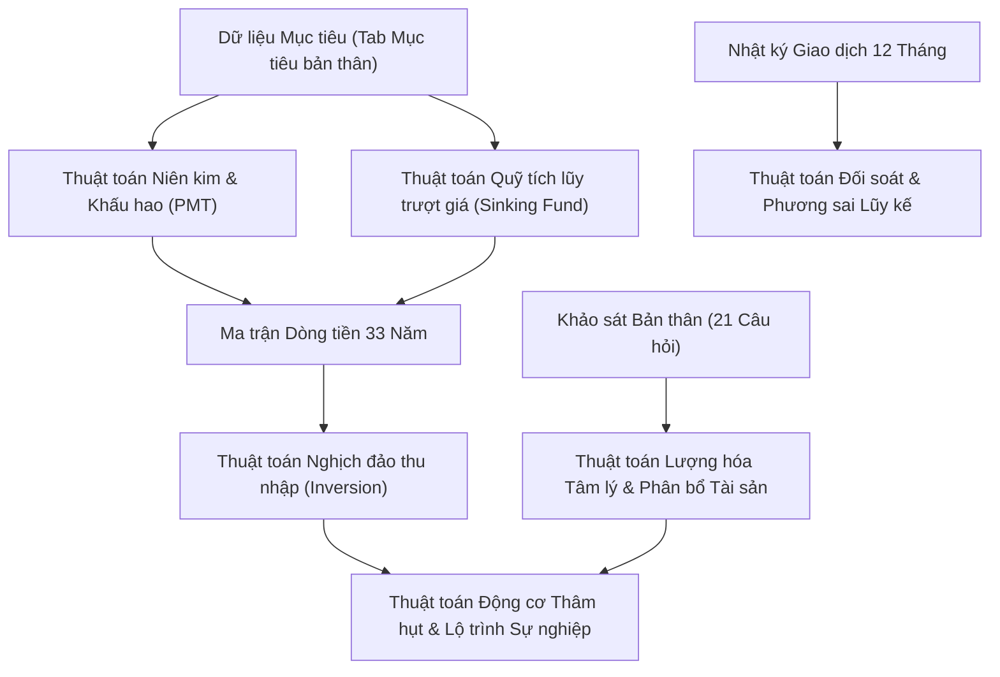
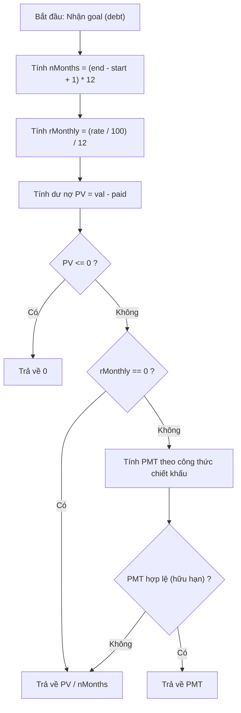
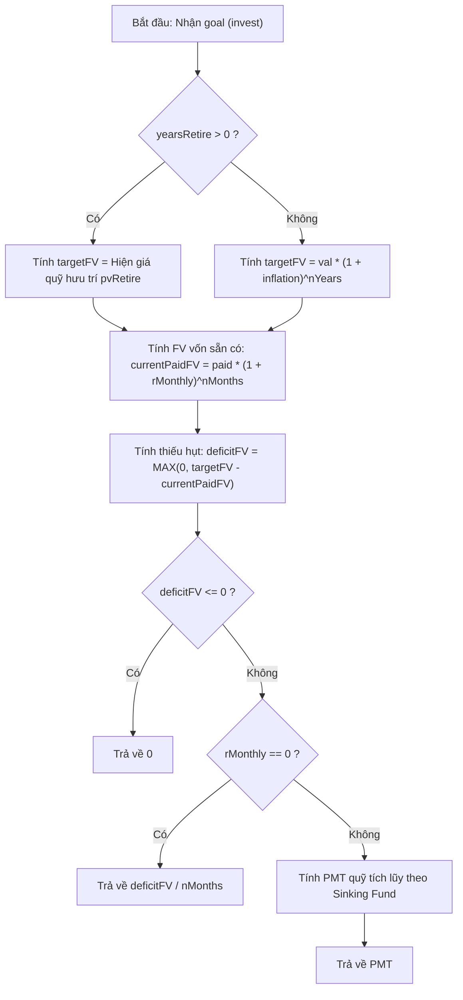
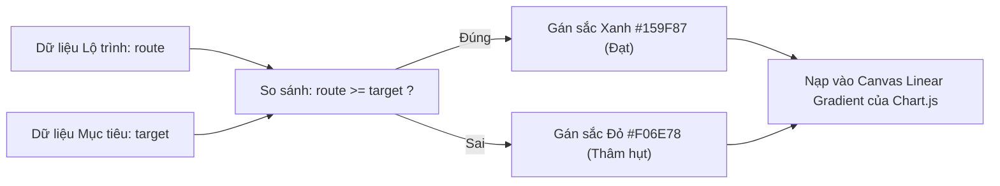
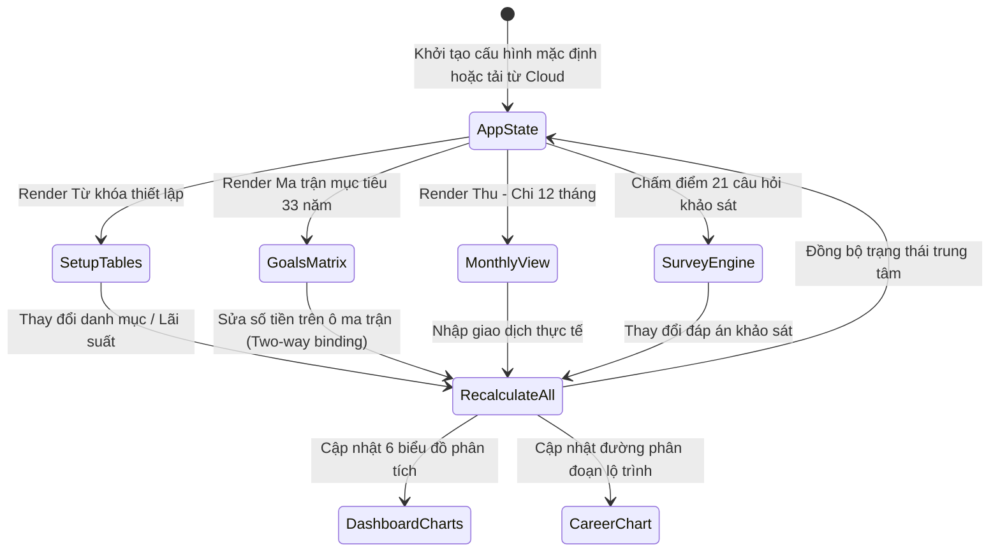

# Bảng Quản Lý & Hoạch Định Tài Chính Cá Nhân Chuyên Sâu

Hệ thống ứng dụng web quản lý tài chính cá nhân, hoạch định ngân sách 12 tháng và dự báo lộ trình tài sản 33 năm, kết hợp giữa mô hình quản trị dòng tiền thực tế, phân bổ tài sản theo chu kỳ cuộc đời và phân tích sự phù hợp giữa lộ trình phát triển sự nghiệp với các mục tiêu dài hạn.

---

## 1. Tổng quan & Hướng dẫn sử dụng

### 1.1. Mục đích cốt lõi
Hệ thống được xây dựng nhằm giải quyết bài toán: **Lượng hóa các mục tiêu cuộc đời thành những con số định lượng cụ thể trên lộ trình nghề nghiệp và tích lũy hàng tháng.** Ứng dụng cung cấp bức tranh tài chính toàn diện từ đối soát thu chi vi mô (hàng tháng) đến kế hoạch tích lũy vĩ mô (33 năm).

### 1.2. Các phân hệ chức năng chính
1. **Từ khóa thiết lập (`tab-tukhoa`):** Quản lý danh mục nguồn thu, khoản chi, danh mục phát triển bản thân và rổ sản phẩm đầu tư tài chính.
2. **Dashboard phân tích (`tab-dashboard`):** Trung tâm giám sát dòng tiền, cơ cấu tài sản, đối soát phương sai và tổng hợp dữ liệu thời gian thực.
3. **Mục tiêu bản thân (`tab-muctieu-bt`):** Bảng nhập liệu trung tâm (Single Source of Input) chứa toàn bộ các mục tiêu nợ, tích lũy, hưu trí, kỹ năng nghề nghiệp và kết quả khảo sát.
4. **Mục tiêu tài chính (`tab-muctieu-tc`):** Phân bổ chi tiết từng mục tiêu và ma trận dòng tiền 33 năm (tính năng Two-way Binding).
5. **Cân đối lộ trình nghề nghiệp (`tab-candoi`):** So khớp thu nhập từ lộ trình thăng tiến với thu nhập cần đạt để hoàn thành các mục tiêu tài chính qua từng độ tuổi.
6. **Kế hoạch thu nhập & chi tiêu (`tab-kehoach`):** Hoạch định ngân sách dự kiến cho 12 tháng trong năm.
7. **Theo dõi thu chi 12 tháng (`tab-month`):** Nhật ký giao dịch thực tế theo từng tháng, đối soát phương sai ngân sách và theo dõi chi phí nâng cao năng lực bản thân.
8. **Khảo sát đánh giá bản thân (`tab-khaosat`):** Hệ thống 21 câu hỏi định lượng chấm điểm khả năng chịu rủi ro và bối cảnh tài chính gia đình.

### 1.3. Công nghệ sử dụng & Cấu trúc thư mục
* **Frontend:** HTML5 ngữ nghĩa, CSS3 Custom Properties (Design Tokens chuẩn WCAG AA, hỗ trợ Light & Dark Mode), Vanilla JavaScript (ES6+).
* **Trực quan hóa dữ liệu:** Chart.js (CDN).
* **Biểu tượng:** FontAwesome 6 (CDN).
* **Đồng bộ đám mây & Sao lưu phiên bản:** Google Cloud Firestore (Firebase Modular Web SDK v10.12.0 qua ES Modules).
* **Kiến trúc dữ liệu:** Mô hình luồng dữ liệu một chiều phản ứng (Reactive One-Way Data Flow) xoay quanh trạng thái trung tâm `AppState`.

#### Cấu trúc thư mục dự án
```text
financials-plan.github.io-main/
├── index.html                           # Giao diện chính (ở ngoài cùng)
├── style.css                            # Toàn bộ CSS giao diện Light/Dark & Responsive (ở ngoài cùng)
├── script.js                            # Logic nghiệp vụ & thuật toán tài chính (ở ngoài cùng)
├── firebase-config.js                   # File cấu hình duy nhất cho phép thay đổi (firebaseConfig, firestoreSettings)
├── README.md                            # Tài liệu tổng quan & mô hình thuật toán
└── firebase/                            # Thư mục riêng chứa toàn bộ lõi cài đặt Firebase
    ├── firestore-service.js             # Mô-đun kết nối Firebase SDK v10.12.0 & định nghĩa window.CloudDB
    ├── firestore.rules                  # Quy tắc bảo mật Cloud Firestore (Rules v2)
    ├── firestore.indexes.json           # Cấu hình miễn trừ chỉ mục (fieldOverrides)
    ├── firebase.json                    # Cấu hình Firebase CLI
    ├── .firebaserc                      # Khai báo Project ID mặc định (financials-plan)
    └── FIRESTORE_SETUP_CHECKLIST.md     # Bảng kiểm tra nhanh quy trình cài đặt
```

### 1.4. Hướng dẫn cài đặt & Chạy ứng dụng

#### A. Cấu hình kết nối Firebase Cloud Firestore (Khi cài đặt Project mới)
Toàn bộ cài đặt sâu của Firebase đã được đóng gói trong thư mục [`./firebase/`](./firebase/). Khi muốn thay đổi sang dự án Firebase của riêng bạn, bạn **chỉ cần chỉnh sửa file [`firebase-config.js`](./firebase-config.js)** ở ngoài cùng:

1. **Tạo Project & Firestore Database:**
   * Truy cập [Firebase Console](https://console.firebase.google.com/), tạo project mới và đăng ký một **Web App (`</>`)** để lấy khối thông số `firebaseConfig`.
   * Vào mục **Build → Firestore Database → Create database**, giữ ID mặc định là `(default)`, chọn **Native Mode**, chọn vị trí máy chủ (`asia-southeast1`) và nhấn **Create**.
2. **Cập nhật thông số vào [`firebase-config.js`](./firebase-config.js):**
   * Mở file [`firebase-config.js`](./firebase-config.js) ở thư mục gốc và thay thế các trường trong `firebaseConfig` (`apiKey`, `authDomain`, `projectId`, `storageBucket`, `messagingSenderId`, `appId`, `measurementId`).
3. **Cài đặt Quy tắc bảo mật (`firestore.rules`) & Miễn trừ chỉ mục (`firestore.indexes.json`):**
   * **Cách 1 (Trực tiếp trên Firebase Console):** Mở **Firestore Database → Rules**, dán nội dung file [`./firebase/firestore.rules`](./firebase/firestore.rules) và nhấn **Publish**. Tại tab **Indexes → Single-field**, thêm miễn trừ (Exemption) tắt lập chỉ mục cho 2 trường `_backups` và `monthlyDetails` thuộc collection `financial_data`.
   * **Cách 2 (Dùng Firebase CLI):**
     ```bash
     cd firebase
     firebase login
     firebase use <project-id>
     firebase deploy --only firestore
     ```
   * *(Xem hướng dẫn cài đặt chi tiết từng bước kèm giải thích đầy đủ trong guideline dưới đây: * *
      [`./firebase/FIRESTORE_SETUP_CHECKLIST.md`](./firebase/FIRESTORE_SETUP_CHECKLIST.md))

#### B. Chạy ứng dụng trên máy cục bộ (Localhost) hoặc GitHub Pages
Do ứng dụng nạp Firebase SDK theo chuẩn ES Modules (`<script type="module" src="./firebase/firestore-service.js">`), cần chạy qua giao thức `http://` hoặc `https://` để trình duyệt không chặn CORS:

1. **Cách 1 (VS Code Live Server — Khuyên dùng):** Nhấp chuột phải vào [`index.html`](./index.html) → chọn **Open with Live Server**.
2. **Cách 2 (Python / Node.js Local Server):**
   ```bash
   # Dùng Python 3:
   python -m http.server 8000
   # Hoặc dùng Node.js:
   npx serve .
   # Truy cập: http://localhost:8000
   ```
3. **Cách 3 (GitHub Pages):** Đẩy toàn bộ mã nguồn lên nhánh `main`, vào **Settings → Pages**, chọn **Deploy from a branch (`main` / `root`)** và nhấn **Save**.

---

## 2. Chi tiết các mô hình thuật toán tài chính



---

### THUẬT TOÁN 1: Mô hình Niên kim & Khấu hao nợ vay định kỳ (Loan Amortization PMT Model)

#### A. Mục tiêu & Vai trò
Tính toán chính xác số tiền cố định người dùng bắt buộc phải thanh toán mỗi tháng (`PMT`) để tất toán một nghĩa vụ nợ (vay mua nhà, mua xe, vay tiêu dùng) trong khung thời gian xác định với mức lãi suất danh nghĩa cho trước.

#### B. Dữ liệu đầu vào và đầu ra
* **Dữ liệu đầu vào (`goal` object có `type === 'debt'`):**
  | Tên biến | Kiểu dữ liệu | Ý nghĩa | Miền giá trị | Xử lý biên |
  | :--- | :--- | :--- | :--- | :--- |
  | `goal.val` | `Number` | Tổng giá trị khoản nợ ban đầu (triệu VNĐ) | >= 0 | Nếu thiếu, mặc định 0 |
  | `goal.paid` | `Number` | Số tiền gốc đã thanh toán sẵn (triệu VNĐ) | >= 0 | Nếu thiếu, mặc định 0 |
  | `goal.rate` | `Number` | Lãi suất danh nghĩa hàng năm (%) | >= 0 | Nếu thiếu, mặc định 8.0% |
  | `goal.start` | `Integer` | Năm bắt đầu tính nghĩa vụ trả nợ | >= 2026 | Mặc định năm hiện tại |
  | `goal.end` | `Integer` | Năm hoàn thành tất toán nợ | >= start | Nếu end < start, lấy start |
* **Dữ liệu đầu ra:**
  * `pmt` (`Number`): Số tiền phải trả hàng tháng (triệu VNĐ/tháng).

#### C. Các bước xử lý
1. Xác định số năm thanh toán: `n_years = max(1, end - start + 1)`.
2. Quy đổi tổng số kỳ thanh toán theo tháng: `n = n_years × 12`.
3. Quy đổi lãi suất danh nghĩa năm sang lãi suất tháng: `r_m = (rate / 100) / 12`.
4. Tính dư nợ gốc thực tế còn lại: `PV = max(0, val - paid)`.
5. **Xử lý rẽ nhánh:**
   * Nếu `PV <= 0`: Khoản nợ đã hết, trả về `0`.
   * Nếu `r_m == 0`: Khoản vay không tính lãi, trả về `PV / n`.
   * Nếu `r_m > 0`: Áp dụng công thức chiết khấu dòng tiền niên kim.
6. **Xử lý an toàn số học:** Nếu kết quả là `NaN` hoặc vô cực (`!isFinite`), fallback về phép chia tuyến tính `PV / n`.

#### D. Công thức toán học & Quy tắc
```text
         PV × r_m × (1 + r_m)^n
PMT = ───────────────────────────
            (1 + r_m)^n - 1
```

Trong đó:
* `PV`: Dư nợ gốc cần hoàn trả (`PV = val - paid`).
* `r_m`: Lãi suất hàng tháng (`r_m = (rate / 100) / 12`).
* `n`: Tổng số tháng hoàn nợ (`n = (end - start + 1) × 12`).

*Ví dụ tính toán:*
Khoản vay mua nhà dư nợ `PV = 1,200 triệu VNĐ`, trả trong 10 năm (`n = 120 tháng`), lãi suất `10%/năm` (`r_m = 0.10 / 12 ≈ 0.008333`):
* `(1 + r_m)^120 = (1.008333)^120 ≈ 2.70704`
* `PMT = (1,200 × 0.008333 × 2.70704) / (2.70704 - 1) ≈ 27.0704 / 1.70704 ≈ 15.858 triệu VNĐ/tháng`

#### E. Pseudocode
```text
FUNCTION calculateMonthlyDebt(val, paid, rate, start, end):
    nYears = MAX(1, end - start + 1)
    nMonths = nYears * 12
    rMonthly = (rate / 100) / 12
    loanBalance = MAX(0, val - paid)

    IF loanBalance <= 0 THEN RETURN 0
    IF rMonthly == 0 THEN RETURN loanBalance / nMonths

    pmt = (loanBalance * rMonthly * (1 + rMonthly)^nMonths) / ((1 + rMonthly)^nMonths - 1)
    IF isNaN(pmt) OR NOT isFinite(pmt) THEN
        RETURN loanBalance / nMonths
    RETURN pmt
END FUNCTION
```

#### F. Sơ đồ luồng (Flowchart)


#### G. Độ phức tạp & Giới hạn
* **Độ phức tạp thời gian:** `O(1)` - các phép tính lũy thừa và số học diễn ra trong thời gian hằng số.
* **Độ phức tạp không gian:** `O(1)` - không phát sinh bộ nhớ đệm phụ thuộc dữ liệu.
* **Giới hạn giả định:** Lãi suất giả định cố định trong suốt kỳ hạn; phương thức tính lãi trên dư nợ giảm dần đều hàng tháng.
* **Vị trí trong mã nguồn:** Hàm [`calculateMonthlyNeed(goal)`](file:///d:/Code%20-%20IT/anything%20without%20cpp/financials-plan.github.io-main/script.js#L610-L625) tại `script.js`.

---

### THUẬT TOÁN 2: Mô hình Quỹ tích lũy trượt giá lạm phát kép & Hưu trí (Inflation-Adjusted Sinking Fund Model)

#### A. Mục tiêu & Vai trò
Xác định số vốn cần trích lập đầu tư định kỳ hàng tháng (`PMT_invest`) để đạt được một mục tiêu tài chính tương lai (mua bất động sản, chuẩn bị học phí cho con cái, quỹ hưu trí). Mô hình tự động bù đắp mức suy giảm sức mua do lạm phát lũy kế và ghi nhận sự gia tăng giá trị theo lãi kép của số vốn đã tích lũy sẵn.

#### B. Dữ liệu đầu vào và đầu ra
* **Dữ liệu đầu vào (`goal` object có `type === 'invest'`):**
  | Tên biến | Kiểu dữ liệu | Ý nghĩa | Miền giá trị |
  | :--- | :--- | :--- | :--- |
  | `goal.val` | `Number` | Giá trị mục tiêu theo thời giá hiện tại (triệu VNĐ) | >= 0 |
  | `goal.paid` | `Number` | Vốn sẵn có đã tích lũy cho mục tiêu này | >= 0 |
  | `goal.inflation`| `Number` | Tỷ lệ trượt giá lạm phát bình quân hàng năm (%) | >= 0 |
  | `goal.rate` | `Number` | Tỷ suất sinh lời kỳ vọng hàng năm của danh mục đầu tư (%) | >= 0 |
  | `goal.yearsRetire` | `Integer` | (Nếu là mục tiêu hưu trí) Số năm rút tiền an dưỡng | >= 0 |
  | `goal.monthlyRetire`| `Number` | (Hưu trí) Mức chi tiêu tháng mong muốn khi nghỉ hưu | >= 0 |
  | `goal.deathFund` | `Number` | (Hưu trí) Số tiền muốn để lại thừa kế khi qua đời | >= 0 |
* **Dữ liệu đầu ra:**
  * `pmtInvest` (`Number`): Số tiền cần đầu tư đều đặn mỗi tháng (triệu VNĐ/tháng).

#### C. Các bước xử lý
1. **Xác định mục tiêu tương lai (`targetFV`):**
   * Nếu có thiết lập hưu trí (`yearsRetire > 0`): Tính toán quy mô quỹ hưu trí cần có tại thời điểm bắt đầu nghỉ hưu bằng công thức hiện giá dòng niên kim rút tiền:
     ```text
                  monthlyRetire × [1 - (1 + r_m)^(-n_r)]          deathFund
     PV_retire = ──────────────────────────────────────── + ────────────────────
                                   r_m                         (1 + r_m)^n_r
     ```
     Gán `targetFV = PV_retire`.
   * Nếu là mục tiêu mua tài sản thông thường: Điều chỉnh lạm phát trượt giá theo số năm:
     ```text
     targetFV = val × (1 + inf)^n_years
     ```
2. **Tính giá trị tương lai của vốn sẵn có (`FV_paid`):**
   Số tiền `paid` được giả định tiếp tục sinh lời với lãi suất kỳ vọng cho đến hạn mục tiêu:
   ```text
   FV_paid = paid × (1 + r_m)^n
   ```
3. **Tính phần thiếu hụt ròng:** `ΔFV = max(0, targetFV - FV_paid)`.
4. **Tính mức tích lũy hàng tháng (`PMT_invest`):**
   Áp dụng thừa số quỹ tích lũy (Sinking Fund Factor):
   ```text
                  ΔFV × r_m
   PMT_invest = ───────────────
                (1 + r_m)^n - 1
   ```

#### D. Công thức toán học
```text
ΔFV = val × (1 + inf)^t - paid × (1 + r_m)^(12t)

              ΔFV × r_m
PMT_invest = ───────────────
             (1 + r_m)^(12t) - 1
```

*Ví dụ tính toán:*
Mục tiêu mua xe ô tô trị giá `val = 600 triệu VNĐ` sau `t = 5 năm` (`n = 60 tháng`). Lạm phát kỳ vọng `inf = 4%/năm`, tỷ suất sinh lời danh mục đầu tư `rate = 10%/năm` (`r_m = 0.10 / 12 ≈ 0.008333`). Số vốn đã có sẵn `paid = 100 triệu VNĐ`:
1. `targetFV = 600 × (1 + 0.04)^5 = 600 × 1.21665 ≈ 729.99 triệu VNĐ`.
2. `FV_paid = 100 × (1 + 0.008333)^60 = 100 × 1.6453 ≈ 164.53 triệu VNĐ`.
3. `ΔFV = 729.99 - 164.53 = 565.46 triệu VNĐ`.
4. `PMT_invest = (565.46 × 0.008333) / (1.6453 - 1) ≈ 4.712 / 0.6453 ≈ 7.30 triệu VNĐ/tháng`.

#### E. Pseudocode
```text
FUNCTION calculateMonthlyInvest(val, paid, rate, inflation, start, end, yearsRetire, monthlyRetire, deathFund):
    nYears = MAX(1, end - start + 1)
    nMonths = nYears * 12
    rMonthly = (rate / 100) / 12
    infRate = (inflation / 100)

    IF yearsRetire > 0 THEN
        nRetireMonths = yearsRetire * 12
        IF rMonthly > 0 THEN
            pvRetire = monthlyRetire * (1 - (1 + rMonthly)^(-nRetireMonths)) / rMonthly
            pvRetire = pvRetire + deathFund / ((1 + rMonthly)^nRetireMonths)
        ELSE
            pvRetire = (monthlyRetire * nRetireMonths) + deathFund
        targetFV = pvRetire
    ELSE
        targetFV = val * (1 + infRate)^nYears
    END IF

    currentPaidFV = paid * (1 + rMonthly)^nMonths
    deficitFV = MAX(0, targetFV - currentPaidFV)

    IF deficitFV <= 0 THEN RETURN 0
    IF rMonthly == 0 THEN RETURN deficitFV / nMonths

    pmt = (deficitFV * rMonthly) / ((1 + rMonthly)^nMonths - 1)
    IF isNaN(pmt) OR NOT isFinite(pmt) THEN
        RETURN deficitFV / nMonths
    RETURN pmt
END FUNCTION
```

#### F. Sơ đồ luồng (Flowchart)


#### G. Độ phức tạp & Giới hạn
* **Độ phức tạp:** `O(1)` thời gian, `O(1)` không gian.
* **Vị trí trong mã nguồn:** Hàm [`calculateMonthlyNeed(goal)`](file:///d:/Code%20-%20IT/anything%20without%20cpp/financials-plan.github.io-main/script.js#L627-L655) tại `script.js`.

---

### THUẬT TOÁN 3: Mô hình Phân bổ tài sản thích ứng theo vòng đời (Lifecycle Asset Allocation Model)

#### A. Mục tiêu & Vai trò
Tự động tính toán cơ cấu tỷ trọng danh mục đầu tư mẫu (Cổ phiếu, Trái phiếu, Bảo hiểm, Tiền mặt) theo quy luật biến thiên của tuổi tác: khi tuổi càng cao, tỷ trọng tài sản rủi ro (cổ phiếu) giảm dần và tỷ trọng tài sản phòng thủ (trái phiếu, bảo hiểm, tiền mặt) tăng dần nhằm bảo toàn thành quả tích lũy.

#### B. Dữ liệu đầu vào và đầu ra
* **Đầu vào:** `AppState.currentAge` (tuổi hiện tại của người dùng).
* **Đầu ra:** Danh sách 6 cột mốc cuộc đời tương ứng với các độ tuổi (`age` tại các mốc `[base, base+5, base+9, base+14, base+19, base+29]`), mỗi mốc gồm:
  * `stocks`: Tỷ trọng Cổ phiếu (%).
  * `bonds`: Tỷ trọng Trái phiếu (%).
  * `ins`: Tỷ trọng Bảo hiểm (%).
  * `cash`: Tỷ trọng Tiền mặt thanh khoản (%).
  * `returnNeed`: Tỷ suất sinh lời kỳ vọng trung bình gia quyền của danh mục (%/năm).

#### C. Công thức toán học & Quy tắc phân bổ
1. **Tỷ trọng Cổ phiếu (`W_stocks`):** Áp dụng biến thể hiện đại của quy tắc kinh điển `100 - Tuổi` kết hợp cận an toàn `[15%, 75%]`:
   ```text
   W_stocks = max(15%, min(75%, 100 - Tuổi + 5))
   ```
2. **Tỷ trọng Trái phiếu (`W_bonds`):** Tăng dần theo tỷ lệ 90% tuổi đời, khống chế trong khoảng `[15%, 60%]`:
   ```text
   W_bonds = min(60%, max(15%, Tuổi × 0.9))
   ```
3. **Tỷ trọng Bảo hiểm phòng hộ (`W_ins`):** Bước nhảy theo giai đoạn trách nhiệm gia đình:
   * Nếu `Tuổi < 35`: `W_ins = 7.0%`
   * Nếu `Tuổi >= 35`: `W_ins = 10.0%`
4. **Tỷ trọng Tiền mặt thanh khoản (`W_cash`):** Phần bù còn lại để tổng danh mục luôn bảo toàn 100%, mức sàn tối thiểu 5%:
   ```text
   W_cash = max(5%, 100% - (W_stocks + W_bonds + W_ins))
   ```
5. **Tỷ suất sinh lời kỳ vọng trung bình gia quyền (`R_avg`):**
   ```text
   R_avg = (W_stocks × 13.5% + W_bonds × 9.5% + W_ins × 4.5% + W_cash × 5.0%) / 100
   ```

#### D. Pseudocode
```text
FUNCTION calculateAgeMilestones():
    baseAge = AppState.currentAge
    offsets = [0, 5, 9, 14, 19, 29]
    milestones = []

    FOR EACH off IN offsets DO:
        age = baseAge + off
        stocks = MAX(15, MIN(75, 100 - age + 5))
        bonds = MIN(60, MAX(15, age * 0.9))
        ins = (age >= 35) ? 10.0 : 7.0
        cash = MAX(5, 100 - (stocks + bonds + ins))
        returnNeed = (stocks * 13.5 + bonds * 9.5 + ins * 4.5 + cash * 5.0) / 100

        milestones.PUSH({ age, stocks, bonds, ins, cash, returnNeed })
    END FOR
    RETURN milestones
END FUNCTION
```

#### E. Độ phức tạp & Vị trí
* **Độ phức tạp:** `O(1)` (vòng lặp 6 phần tử cố định).
* **Vị trí trong mã nguồn:** Hàm [`calculateAgeMilestones()`](file:///d:/Code%20-%20IT/anything%20without%20cpp/financials-plan.github.io-main/script.js#L668-L695) tại `script.js`.

---

### THUẬT TOÁN 4: Nghịch đảo thu nhập từ tỷ lệ tiết kiệm mục tiêu (Savings-to-Income Inversion)

#### A. Mục tiêu & Vai trò
Thay vì cách tiếp cận bị động "Thu nhập trừ Chi tiêu bằng Tiết kiệm", hệ thống hoạt động theo triết lý "Trả cho bản thân trước" (*Pay Yourself First*). Bằng cách tổng hợp toàn bộ các khoản tích lũy và trả nợ bắt buộc trong năm `y` (`∑ PMT`), thuật toán đảo ngược để tính mức thu nhập ròng tối thiểu mỗi tháng người dùng cần tạo ra (`I_target`) để đảm bảo không bị vỡ kế hoạch tài chính.

#### B. Dữ liệu đầu vào và đầu ra
* **Đầu vào:**
  * `yearOffset`: Khoảng lệch năm tính từ năm hiện tại (`0 <= yearOffset <= 32`).
  * Danh sách `AppState.tcGoals` chứa toàn bộ các mục tiêu đang kích hoạt.
* **Đầu ra:**
  * `incNeed` (`Number`): Thu nhập tối thiểu cần có (triệu VNĐ/tháng).

#### C. Công thức toán học
1. **Tổng nhu cầu tiết kiệm tháng trong năm `y` (`S_sum`):**
   ```text
   S_sum(y) = ∑ PMT(g)   với mọi mục tiêu g có hiệu lực trong năm y
   ```
2. **Nghịch đảo mức thu nhập mục tiêu với tỷ lệ tiết kiệm chuẩn 40%:**
   ```text
   I_target(y) = S_sum(y) / 0.40   khi S_sum(y) > 0
   I_target(y) = 0                 khi S_sum(y) == 0
   ```

#### D. Pseudocode
```text
FUNCTION getMatrixIncomeNeed(yearOffset):
    sSum = 0
    targetYear = AppState.currentYear + yearOffset

    FOR EACH goal IN AppState.tcGoals DO:
        IF targetYear >= goal.start AND targetYear <= goal.end THEN
            sSum = sSum + (goal.monthly != null ? goal.monthly : calculateMonthlyNeed(goal))
        END IF
    END FOR

    IF sSum > 0 THEN
        RETURN sSum / 0.40
    ELSE
        RETURN 0
    END IF
END FUNCTION
```

#### E. Độ phức tạp & Vị trí
* **Độ phức tạp:** `O(G)` với `G` là tổng số lượng mục tiêu tài chính (`G <= 50`, tức thời gian tính toán tức thì `< 1ms`).
* **Vị trí trong mã nguồn:** Hàm [`getMatrixIncomeNeed()`](file:///d:/Code%20-%20IT/anything%20without%20cpp/financials-plan.github.io-main/script.js#L657-L666) tại `script.js`.

---

### THUẬT TOÁN 5: Động cơ Thâm hụt sự nghiệp & Chuyển màu đồ họa phân đoạn (Career Deficit Engine)

#### A. Mục tiêu & Vai trò
Đối soát trên từng mốc tuổi giữa khả năng tạo thu nhập từ lộ trình công việc (`route`) và áp lực dòng tiền từ các mục tiêu tài chính (`target`). Nhận diện nguy cơ thâm hụt và trực quan hóa cảnh báo bằng kỹ thuật đổi màu phân đoạn liên tục (*Canvas Linear Gradient*) trên biểu đồ Chart.js.

#### B. Dữ liệu đầu vào và đầu ra
* **Đầu vào:** Mảng đối tượng sự nghiệp theo từng độ tuổi gồm `age`, `route` (thu nhập dự kiến kiếm được), `target` (thu nhập cần có từ Thuật toán 4).
* **Đầu ra:**
  * Độ lệch thu nhập: `ΔI = route - target`.
  * Phân đoạn trạng thái: `Đạt` hoặc `Thâm hụt`.
  * Gradient chuyển màu trên trục thời gian của biểu đồ đường: sắc xanh `#159F87` cho vùng thặng dư và sắc đỏ `#F06E78` cho vùng thiếu hụt.

#### C. Công thức phân đoạn màu Canvas Gradient
Với mảng `M` điểm dữ liệu trên trục hoành (`0 <= i < M`):
```text
stop_i = i / (M - 1)

Color_i = #159F87 (Xanh lục)   khi route_i >= target_i
Color_i = #F06E78 (Đỏ hồng)    khi route_i < target_i
```

#### D. Sơ đồ xử lý (Flowchart)


#### E. Vị trí trong mã nguồn
* Hàm [`calculateCareerDetails()`](file:///d:/Code%20-%20IT/anything%20without%20cpp/financials-plan.github.io-main/script.js#L697-L739) và [`renderCareerChart()`](file:///d:/Code%20-%20IT/anything%20without%20cpp/financials-plan.github.io-main/script.js#L2540-L2645) tại `script.js`.

---

### THUẬT TOÁN 6: Đối soát & Phương sai ngân sách lũy kế 12 tháng (Budget Variance Engine)

#### A. Mục tiêu & Vai trò
Đo lường kỷ luật tài chính trong năm thực tế thông qua việc so sánh liên tục giữa kế hoạch đã định (`Plan`) và số tiền thực tế phát sinh (`Actual`). Cảnh báo sớm xu hướng bội chi tích lũy qua chỉ số phương sai lũy kế (`CumDiff`).

#### B. Công thức toán học
1. **Phương sai chi phí tháng `m`:**
   ```text
   Variance_m = Actual_m - Plan_m
   ```
   * `Variance_m <= 0`: Chi tiêu trong hạn mức (Tiết kiệm ngân sách).
   * `Variance_m > 0`: Bội chi ngân sách (Cảnh báo đỏ).
2. **Phương sai lũy kế 12 tháng (`CumDiff_m`):**
   ```text
   CumDiff_m = ∑ (Actual_k - Plan_k)   (với k chạy từ 1 đến m)
   ```

#### C. Vị trí trong mã nguồn
* Hàm [`renderReconciliationTable(m)`](file:///d:/Code%20-%20IT/anything%20without%20cpp/financials-plan.github.io-main/script.js#L2084-L2150) và biểu đồ `chartDashVariance` tại [`renderDashboardAllCharts()`](file:///d:/Code%20-%20IT/anything%20without%20cpp/financials-plan.github.io-main/script.js#L1339-L1385).

---

### THUẬT TOÁN 7: Lượng hóa tâm lý khảo sát & Khuyến nghị đầu tư (Psychometric Scoring Engine)

#### A. Mục tiêu & Vai trò
Chuyển đổi các câu trả lời định tính trong 21 câu hỏi trắc nghiệm thành điểm số định lượng chuẩn xác nhằm xác định:
1. **Khả năng chịu đựng rủi ro (`S_1`):** Đánh giá tâm lý đối diện với thua lỗ và tầm nhìn đầu tư.
2. **Bối cảnh & Hoàn cảnh tài chính (`S_2`):** Đánh giá nguồn lực hậu thuẫn từ gia đình, nghĩa vụ phụ thuộc và độ ổn định của sự nghiệp.

#### B. Quy tắc tính điểm và Ngưỡng phân loại

1. **Phần 1: Khảo sát rủi ro (10 câu hỏi, điểm `S_1` từ 10 đến 50):**
   ```text
   S_1 = ∑ weights_q[choice_q]   (với q từ câu 1 đến 10)
   ```
   * **`S_1 < 18` (Thận trọng - Ngại rủi ro):** Duy trì tỷ trọng tài sản rủi ro ở mức thấp; ưu tiên tiền gửi và trái phiếu an toàn.
   * **`18 <= S_1 < 28` (Cân bằng - Trung lập rủi ro):** Duy trì tỷ trọng cân bằng giữa tăng trưởng và an toàn vốn.
   * **`S_1 >= 28` (Tăng trưởng - Chấp nhận rủi ro):** Có thể gia tăng mạnh tỷ trọng cổ phiếu và quỹ đầu tư tăng trưởng.

2. **Phần 2: Khảo sát hoàn cảnh (11 câu hỏi, điểm `S_2` từ 11 đến 55):**
   ```text
   S_2 = ∑ weights_q[choice_q]   (với q từ câu 1 đến 11)
   ```
   * **`S_2 <= 20`:** Điều kiện không thuận lợi.
   * **`21 <= S_2 <= 29`:** Điều kiện ít thuận lợi.
   * **`30 <= S_2 <= 38`:** Điều kiện bình thường.
   * **`39 <= S_2 <= 41`:** Điều kiện thuận lợi.
   * **`S_2 >= 42`:** Điều kiện cực kỳ thuận lợi.

#### C. Vị trí trong mã nguồn
* Mảng câu hỏi và trọng số: `surveyQuestionsPart1` & `surveyQuestionsPart2` ([Dòng 582-608](file:///d:/Code%20-%20IT/anything%20without%20cpp/financials-plan.github.io-main/script.js#L582-L608)).
* Hàm tính điểm: [`evaluateSurveys()`](file:///d:/Code%20-%20IT/anything%20without%20cpp/financials-plan.github.io-main/script.js#L2949-L3015) tại `script.js`.

---

## 3. Kiến trúc luồng dữ liệu trung tâm (`AppState`)



Mọi tương tác từ người dùng đều kích hoạt hàm nhạc trưởng [`recalculateAll()`](file:///d:/Code%20-%20IT/anything%20without%20cpp/financials-plan.github.io-main/script.js#L3541) tại `script.js`, đảm bảo dữ liệu luôn được tính toán lại theo chuỗi phụ thuộc và không bao giờ xảy ra tình trạng lệch số liệu giữa các tab chức năng.
