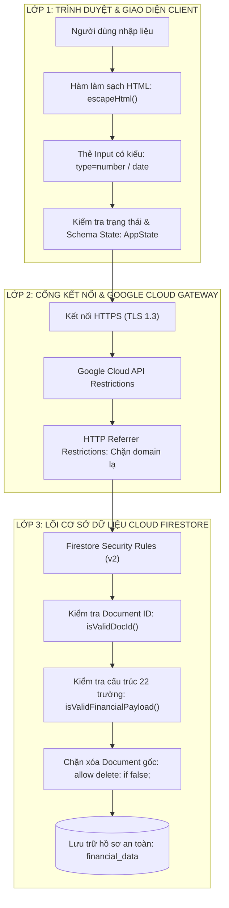

# CHÍNH SÁCH & HƯỚNG DẪN CẤU HÌNH BẢO MẬT (SECURITY POLICY & CONFIGURATION GUIDE)

Tài liệu này xác định các chính sách an toàn thông tin, mô hình phòng thủ theo chiều sâu (Defense-in-Depth) và hướng dẫn chi tiết từng bước để cấu hình bảo mật toàn diện cho hệ thống **Quản lý & Hoạch định Tài chính Cá nhân** (`financials-plan.github.io`).

---

## 1. Chính sách bảo mật dự án (Project Security Policy)

### 1.1. Các phiên bản được hỗ trợ (Supported Versions)

Hệ thống được phát triển theo mô hình phân phối liên tục (Continuous Delivery) trên nhánh chính của kho lưu trữ. Các bản vá bảo mật sẽ được ưu tiên phát hành trực tiếp trên nhánh production:

| Phiên bản / Nhánh | Trạng thái hỗ trợ bảo mật | Ghi chú |
| :--- | :--- | :--- |
| **`main` (Mới nhất)** | :white_check_mark: Được hỗ trợ đầy đủ | Nhánh triển khai trực tiếp lên GitHub Pages |
| **Các nhánh phát triển / tính năng** | :x: Không hỗ trợ | Chỉ sử dụng trong môi trường thử nghiệm nội bộ |
| **Phiên bản cũ đã qua lưu trữ** | :x: Không hỗ trợ | Khuyến nghị cập nhật lên nhánh `main` mới nhất |

### 1.2. Quy trình báo cáo lỗ hổng an ninh (Reporting a Vulnerability)

Chúng tôi cam kết xử lý nghiêm túc mọi thông báo về lỗ hổng bảo mật theo nguyên tắc **Tiết lộ có điều phối (Coordinated Vulnerability Disclosure - CVD)**:

> [!IMPORTANT]
> **KHÔNG MỞ PUBLIC ISSUE** trên GitHub đối với các vấn đề liên quan đến lỗ hổng an ninh hoặc dữ liệu nhạy cảm. Thao tác này có thể khiến hệ thống và người dùng khác gặp nguy cơ bị khai thác trước khi bản vá được phát hành.

1. **Kênh tiếp nhận bí mật:**
   - Sử dụng tính năng **Private Vulnerability Reporting** tại mục [Security Advisories](../../security/advisories/new) của kho lưu trữ GitHub này.
   - Hoặc gửi email trực tiếp tới người quản trị dự án kèm thông tin mô tả chi tiết.
2. **Nội dung báo cáo cần cung cấp:**
   - Mô tả ngắn gọn về loại lỗ hổng (ví dụ: XSS, Firestore Rules Bypass, API Key Quota Exhaustion, v.v.).
   - Các bước tái hiện cụ thể (Proof of Concept - PoC) hoặc mã khai thác thử nghiệm.
   - Mức độ ảnh hưởng ước tính đối với dữ liệu người dùng và tính toàn vẹn của hệ thống.
   - Giải pháp khắc phục đề xuất (nếu có).
3. **Thời gian phản hồi cam kết:**
   - **Xác nhận tiếp nhận:** Trong vòng **24 - 48 giờ** kể từ khi nhận được báo cáo.
   - **Đánh giá & Tái hiện:** Trong vòng **3 - 5 ngày làm việc**.
   - **Phát hành bản vá (Hotfix):** Ưu tiên triển khai trong vòng **7 ngày** đối với các lỗ hổng mức độ Nghiêm trọng (Critical) hoặc Cao (High).

---

## 2. Mô hình kiến trúc an ninh (Security Architecture & Threat Model)

Hệ thống hoạt động theo mô hình **Client-Side Jamstack kết hợp Cloud Backend không máy chủ (Serverless)**. Do mã nguồn frontend chạy hoàn toàn trên trình duyệt người dùng, an ninh hệ thống được thiết lập theo mô hình **Ba lớp phòng thủ (3-Layer Defense)**:



### Bảng phân tích rủi ro & giải pháp bảo vệ

| Nguy cơ tấn công (Threat Vector) | Mức độ rủi ro | Cơ chế phòng thủ đã triển khai trong hệ thống |
| :--- | :---: | :--- |
| **XSS (Cross-Site Scripting)** | Cao | Làm sạch toàn bộ dữ liệu hiển thị bằng hàm `escapeHtml()`; thay thế `contenteditable` bằng thẻ `<input>` thuần túy. |
| **Ghi đè hoặc phá hủy hồ sơ người khác** | Nghiêm trọng | Phân vùng tài liệu `user_<slug>`; Security Rules kiểm tra `_userMeta.userDocId == docId`; chặn lệnh `delete` trên document gốc. |
| **Bom dung lượng (Storage Exhaustion / DoS)** | Trung bình | Khống chế kích thước hồ sơ `< 900 KB` tại client; giới hạn tối đa `20` bản sao lưu; kiểm tra kích thước chuỗi trong Security Rules. |
| **Đánh cắp API Key để gọi dịch vụ khác** | Trung bình | Khóa API Key chỉ dùng cho Cloud Firestore; giới hạn HTTP Referrer chỉ cho phép domain GitHub Pages và localhost. |
| **Mất mát dữ liệu do thao tác nhầm** | Cao | Hộp thoại xác nhận nội bộ (Custom Modal Dialogs) cho mọi thao tác xóa / ghi đè / khôi phục; cảnh báo `beforeunload` khi rời trang. |

---

## 3. Cấu hình bảo vệ API Key trên Google Cloud Platform

> [!NOTE]
> Trong các ứng dụng Web Client-side sử dụng Firebase, `apiKey` nằm trong file `firebase-config.js` là mã định danh dự án công khai (Public Project Identifier). Bản thân `apiKey` không phải là Secret Key. Tuy nhiên, **BẮT BUỘC** phải cấu hình giới hạn (Restrictions) trên Google Cloud Console để ngăn chặn bên thứ ba lạm dụng key cho các mục đích khác.

### 3.1. Thiết lập giới hạn ứng dụng (Application Restrictions)

1. Mở [Google Cloud Console Credentials](https://console.cloud.google.com/apis/credentials).
2. Chọn dự án Firebase của bạn (ví dụ: `financials-plan`).
3. Trong bảng **API Keys**, nhấp vào khóa đang được ứng dụng web sử dụng (thường có tên `Browser key (auto created by Firebase)`).
4. Tại mục **Set application restrictions**, chọn **Websites (HTTP referrers)**.
5. Thêm các URL được phép gửi yêu cầu:
   - `https://financials-plan.github.io/*` *(Tên miền GitHub Pages chính thức)*
   - `https://<ten-mien-tuy-chinh>/*` *(Nếu sử dụng Custom Domain)*
   - `http://localhost:*` *(Chỉ dùng cho môi trường phát triển cục bộ)*
   - `http://127.0.0.1:*` *(Môi trường phát triển cục bộ)*
6. Nhấn **Save**.

```text
[Browser Request] ──(Header: Referer)──> [Google Cloud Gateway]
                                                  │
                ┌─────────────────────────────────┴─────────────────────────────────┐
                ▼                                                                   ▼
       Thuộc danh sách cho phép                                          Tên miền lạ / Postman / cURL
 (https://*.github.io, localhost)                                           (HTTP 403 Forbidden)
                │                                                                   │
                ▼                                                                   ▼
       Cho phép gọi Firestore                                           Từ chối kết nối ngay lập tức
```

### 3.2. Thiết lập giới hạn dịch vụ (API Restrictions)

Mặc định, một API Key mới có thể gọi mọi dịch vụ Google Cloud nếu không được khóa lại. Hãy giới hạn phạm vi dịch vụ:

1. Trong trang chỉnh sửa khóa API Key ở trên, chuyển xuống phần **API restrictions**.
2. Chọn **Restrict key**.
3. Trong danh sách thả xuống, **CHỈ TÍCH CHỌN** các API thực sự cần thiết cho ứng dụng:
   - :white_check_mark: **Cloud Firestore API**
   - :white_check_mark: **Firebase Installations API**
   - :white_check_mark: **Firebase Management API** *(Nếu có)*
4. Không tích chọn bất kỳ API nào khác (Google Maps, Compute Engine, BigQuery, Cloud Translation, v.v.).
5. Nhấn **Save**.

### 3.3. Thiết lập cảnh báo ngân sách (Budget & Quota Alerts)

Để tránh tình trạng phát sinh chi phí bất thường nếu xảy ra tấn công lặp lại:

1. Mở [Google Cloud Billing → Budgets & alerts](https://console.cloud.google.com/billing/budgets).
2. Tạo cảnh báo ngân sách (ví dụ: `1$ - 5$ / tháng`).
3. Cài đặt ngưỡng thông báo gửi về email quản trị viên khi chi phí đạt **50%**, **90%**, và **100%**.

---

## 4. Cấu hình & Nguyên lý Cloud Firestore Security Rules

Toàn bộ quy tắc bảo mật của cơ sở dữ liệu đã được tối ưu hóa trong file [`./backend/firestore.rules`](./backend/firestore.rules). Dưới đây là phân tích chi tiết nguyên lý hoạt động:

### 4.1. Phân vùng dữ liệu người dùng độc lập (Tenant Isolation)

Ứng dụng không sử dụng tài khoản đăng nhập Firebase Auth tập trung mà sử dụng cơ chế định danh hồ sơ theo định dạng chuẩn hóa:
- **Chuẩn hóa Document ID:** Kiểm tra qua biểu thức chính quy (Regex):
  ```javascript
  function isValidDocId(docId) {
    return docId == 'main_financial_record'
        || docId.matches('^user_[a-z0-9_]{1,64}$');
  }
  ```
- **Chống làm giả ID:** Khi người dùng gửi dữ liệu lên, trường `_userMeta.userDocId` bên trong bản ghi bắt buộc phải trùng khớp tuyệt đối với `docId` trên đường dẫn URL của Firestore:
  ```javascript
  data._userMeta.userDocId == docId
  ```

### 4.2. Kiểm tra tính toàn vẹn cấu trúc dữ liệu (Schema Enforcement)

Khi lưu trữ (lệnh `setDoc`), Firestore sẽ từ chối bất kỳ payload nào sai kiểu hoặc vượt ngưỡng an toàn:

```javascript
function isValidFinancialPayload(data, docId) {
  return data.keys().hasAll(['currentYear', 'currentAge', '_lastUpdated', '_userMeta'])
      && data.currentYear is number && data.currentYear >= 1900 && data.currentYear <= 2100
      && data.currentAge is number && data.currentAge >= 1 && data.currentAge <= 120
      && data._lastUpdated is string && data._lastUpdated.size() >= 10 && data._lastUpdated.size() <= 40
      && data._userMeta is map
      && data._userMeta.keys().hasAll(['rawName', 'normalizedName', 'userDocId', 'lastSavedAt'])
      && data._userMeta.userDocId == docId
      && (!('tcGoals' in data) || data.tcGoals is list)
      && (!('planIncome' in data) || data.planIncome is list)
      && (!('planExpense' in data) || data.planExpense is list)
      && (!('investProducts' in data) || data.investProducts is list)
      && (!('monthlyDetails' in data) || data.monthlyDetails is map)
      && (!('surveyP1Choices' in data) || data.surveyP1Choices is map)
      && (!('surveyP2Choices' in data) || data.surveyP2Choices is map)
      && (!('_backups' in data) || (data._backups is list && data._backups.size() <= 20));
}
```

### 4.3. Bảo vệ dữ liệu chống xóa sổ (Immutable Document Protection)

```javascript
// Bảo vệ an toàn dữ liệu: Tuyệt đối không cho phép xóa toàn bộ document hồ sơ từ client
allow delete: if false;
```
- Người dùng chỉ có quyền xóa từng bản sao lưu lịch sử thông qua thao tác cập nhật mảng `_backups` (được thẩm định qua hàm `isValidBackupUpdate`).
- Không có bất kỳ đoạn mã frontend nào có thể phát lệnh `deleteDoc()` xóa sổ hoàn toàn tài liệu trên đám mây.

### 4.4. Nguyên tắc mặc định từ chối (Default Deny)

Mọi đường dẫn, collection, subcollection ngoài `financial_data/{docId}` đều bị chặn 100%:
```javascript
match /{document=**} {
  allow read, write: if false;
}
```

### 4.5. Triển khai Security Rules lên máy chủ

#### Cách 1: Triển khai nhanh bằng Firebase Console
1. Truy cập [Firebase Console → Firestore Database → tab Rules](https://console.firebase.google.com/).
2. Xóa bỏ nội dung cũ, sao chép toàn bộ mã trong file [`./backend/firestore.rules`](./backend/firestore.rules) dán vào ô soạn thảo.
3. Nhấn **Publish**.

#### Cách 2: Triển khai tự động bằng Firebase CLI
Mở terminal tại thư mục gốc của dự án:
```bash
cd backend
firebase login
firebase use financials-plan
firebase deploy --only firestore:rules
```

---

## 5. Cấu hình miễn trừ chỉ mục (Single-Field Index Exemptions)

File cấu hình [`./backend/firestore.indexes.json`](./backend/firestore.indexes.json) vô hiệu hóa việc tự động đánh chỉ mục đơn trường (Single-field Index) đối với hai trường dữ liệu lớn:
1. `_backups`: Mảng chứa tối đa 20 bản sao lưu lịch sử của hồ sơ.
2. `monthlyDetails`: Đối tượng chứa chi tiết giao dịch thu chi của 12 tháng.

```json
{
  "indexes": [],
  "fieldOverrides": [
    {
      "collectionGroup": "financial_data",
      "fieldPath": "_backups",
      "indexes": []
    },
    {
      "collectionGroup": "financial_data",
      "fieldPath": "monthlyDetails",
      "indexes": []
    }
  ]
}
```

> [!TIP]
> **Lợi ích an ninh & hiệu năng:** 
> - Ngăn chặn tình trạng bùng nổ số lượng chỉ mục ngầm (Index Explosion).
> - Giảm thiểu số lượt ghi ngầm vào Firestore, giúp tiết kiệm chi phí và tránh hiện tượng nghẽn giới hạn ghi (Write Rate Limits).

Triển khai cấu hình chỉ mục bằng lệnh:
```bash
cd firebase
firebase deploy --only firestore:indexes
```

---

## 6. Cấu hình Content Security Policy (CSP) & HTTP Headers

Khi triển khai ứng dụng trên GitHub Pages, Netlify, Vercel, Firebase Hosting hoặc máy chủ Web độc lập (Nginx / Apache), khuyến nghị cấu hình các tiêu đề bảo mật (Security Headers) chuẩn OWASP.

### 6.1. Header Content-Security-Policy đề xuất

```http
Content-Security-Policy: default-src 'self'; script-src 'self' 'unsafe-inline' https://cdn.jsdelivr.net https://cdnjs.cloudflare.com https://www.gstatic.com; style-src 'self' 'unsafe-inline' https://cdnjs.cloudflare.com https://fonts.googleapis.com; font-src 'self' https://cdnjs.cloudflare.com https://fonts.gstatic.com data:; img-src 'self' data: https:; connect-src 'self' https://firestore.googleapis.com https://*.firebaseio.com https://*.googleapis.com wss://*.firebaseio.com; frame-ancestors 'none'; base-uri 'self'; form-action 'self';
```

### 6.2. Phân tích các chỉ thị CSP

| Chỉ thị (Directive) | Nguồn cho phép (Allowed Sources) | Mục đích bảo mật |
| :--- | :--- | :--- |
| **`default-src`** | `'self'` | Mặc định chỉ tải tài nguyên từ chính origin của trang web |
| **`script-src`** | `'self' 'unsafe-inline' cdn.jsdelivr.net cdnjs.cloudflare.com www.gstatic.com` | Cho phép mã JavaScript cục bộ, Chart.js, FontAwesome và Firebase SDK từ Google CDN |
| **`connect-src`** | `'self' firestore.googleapis.com *.firebaseio.com *.googleapis.com wss://*.firebaseio.com` | Cho phép gọi REST API & WebSocket đồng bộ dữ liệu hai chiều với Cloud Firestore |
| **`style-src`** | `'self' 'unsafe-inline' cdnjs.cloudflare.com fonts.googleapis.com` | Cho phép tải style hệ thống và Google Fonts |
| **`font-src`** | `'self' cdnjs.cloudflare.com fonts.gstatic.com data:` | Cho phép tải font icon của FontAwesome và WebFonts |
| **`frame-ancestors`** | `'none'` | Chặn đứng hoàn toàn nguy cơ Clickjacking (ngăn nhúng website vào `<iframe>` ngoài) |

### 6.3. Cấu hình thẻ `<meta>` trong `index.html` (Nếu máy chủ không hỗ trợ gán header)

Nếu triển khai thuần túy trên GitHub Pages (không thể tùy chỉnh Response Header từ web server), bạn có thể bổ sung thẻ meta bảo vệ vào thẻ `<head>` của [`index.html`](./index.html):

```html
<meta http-equiv="Content-Security-Policy" content="default-src 'self'; script-src 'self' 'unsafe-inline' https://cdn.jsdelivr.net https://cdnjs.cloudflare.com https://www.gstatic.com; style-src 'self' 'unsafe-inline' https://cdnjs.cloudflare.com https://fonts.googleapis.com; font-src 'self' https://cdnjs.cloudflare.com https://fonts.gstatic.com data:; img-src 'self' data: https:; connect-src 'self' https://firestore.googleapis.com https://*.firebaseio.com https://*.googleapis.com wss://*.firebaseio.com; frame-ancestors 'none'; base-uri 'self';">
<meta http-equiv="X-Content-Type-Options" content="nosniff">
<meta name="referrer" content="strict-origin-when-cross-origin">
```

---

## 7. Cơ chế phòng thủ phía Client (Client-Side Hardening)

Mã nguồn trong [`script.js`](./script.js) và [`style.css`](./style.css) đã được gia cố với các tiêu chuẩn an toàn:

### 7.1. Chống chèn mã độc (XSS Prevention)

Toàn bộ các giá trị chuỗi do người dùng nhập (Tên danh mục, mô tả chi tiêu, ghi chú đối soát, họ tên hồ sơ) khi render vào DOM đều đi qua hàm mã hóa ký tự đặc biệt:

```javascript
function escapeHtml(str) {
  if (str === null || str === undefined) return '';
  return String(str)
    .replace(/&/g, '&amp;')
    .replace(/</g, '&lt;')
    .replace(/>/g, '&gt;')
    .replace(/"/g, '&quot;')
    .replace(/'/g, '&#039;');
}
```

### 7.2. Kiểm soát ô nhập liệu & Ràng buộc kiểu dữ liệu

- Loại bỏ hoàn toàn thuộc tính `contenteditable="true"` tại các ô nhập số tiền và nội dung nhạy cảm.
- Thay thế bằng thẻ `<input type="number" step="any" min="0">` có kiểm tra số thực hai tầng (`replace(/,/g, '.')` và `parseFloat`), ngăn chặn việc dán mã script hoặc chuỗi độc hại vào luồng tính toán.

### 7.3. Bảo vệ lưu trữ cục bộ (`localStorage`)

- Các khóa lưu trữ cục bộ được cô lập với tiền tố `FIN_`:
  - `FIN_APP_THEME`: Lưu theme Light / Dark.
  - `FIN_LAST_USER_NAME`: Lưu tên người dùng đang làm việc gần nhất.
  - `FIN_CURRENT_USER_DOC_ID`: Lưu định danh hồ sơ đang mở.
- Toàn bộ lệnh gọi `localStorage` đều được bọc trong khối `try ... catch` để đảm bảo ứng dụng hoạt động trơn tru ngay cả khi người dùng duyệt web ở chế độ ẩn danh (Incognito) hoặc bị trình duyệt chặn cookie bên thứ ba.

### 7.4. Bảo vệ chủ quyền dữ liệu & Chống mất mát thông tin

- **Hộp thoại nội bộ (In-App Modals):** Không dùng các hộp thoại mặc định `alert()`, `confirm()`, `prompt()` của trình duyệt cho các luồng thao tác dữ liệu nguy hiểm. Toàn bộ thao tác xóa bản sao lưu, khôi phục bản sao lưu hoặc ghi đè hồ sơ đều qua hộp thoại xác nhận chuyên biệt có trạng thái loading và nút Hủy an toàn.
- **Cảnh báo trước khi thoát trang:** Lắng nghe sự kiện `beforeunload` để nhắc nhở người dùng lưu dữ liệu lên đám mây hoặc xuất file JSON trước khi đóng tab trình duyệt.
- **Xuất / Nhập JSON độc lập (Data Sovereignty):** Người dùng có toàn quyền tải trọn bộ dữ liệu tài chính về máy tính cá nhân dưới định dạng `.json` không phụ thuộc vào Firebase hay GitHub. Khi nhập file JSON, hệ thống kiểm tra tính hợp lệ của cấu trúc trước khi merge vào bộ nhớ `AppState`.

---

## 8. Checklist kiểm tra an ninh trước khi triển khai (Production Security Checklist)

Sử dụng bảng kiểm tra này trước mỗi lần cập nhật phiên bản hoặc chuyển giao hệ thống:

- [ ] **1. API Key Restrictions:** Đã cấu hình HTTP Referrers chỉ cho phép tên miền production (`https://*.github.io/*`) và localhost.
- [ ] **2. API Scope:** Đã khóa API Key chỉ dùng riêng cho Cloud Firestore API.
- [ ] **3. Security Rules:** Đã triển khai [`firestore.rules`](./backend/firestore.rules) lên Firebase Console và xác nhận rule version là `2`.
- [ ] **4. Rules Simulation:** Đã chạy thử nghiệm Rules Playground với quyền truy cập giả lập không đúng `isValidDocId` để đảm bảo bị chặn (Denied).
- [ ] **5. Index Overrides:** Đã triển khai [`firestore.indexes.json`](./backend/firestore.indexes.json) để tắt đánh chỉ mục cho `_backups` và `monthlyDetails`.
- [ ] **6. Schema Integrity:** Dữ liệu mẫu kiểm tra hợp lệ với 22 trường bắt buộc và trường `_userMeta.userDocId`.
- [ ] **7. Root Delete Block:** Xác nhận không thể thực hiện lệnh xóa document hồ sơ gốc (`allow delete: if false`).
- [ ] **8. Size Ceiling:** Kiểm tra dung lượng tài liệu luôn duy trì dưới ngưỡng `900 KB` (`maxSafeBytes`).
- [ ] **9. No Secrets in Code:** Không có mật khẩu, private key của service account hoặc thông tin quản trị viên nhạy cảm bị commit vào repository.
- [ ] **10. HTTPS Enforced:** Trang web chạy 100% qua kết nối mã hóa HTTPS trên GitHub Pages.
- [ ] **11. In-App Modals:** Mọi thao tác hủy / xóa / khôi phục đều yêu cầu xác nhận qua hộp thoại giao diện website.
- [ ] **12. Budget Alerts:** Đã kích hoạt cảnh báo ngân sách trên Google Cloud Billing.

---

## 9. Kế hoạch ứng phó sự cố an ninh (Incident Response Plan)

Trong trường hợp phát hiện dấu hiệu bất thường (như lưu lượng gọi Firestore tăng đột biến, nghi ngờ API Key bị lạm dụng từ bên ngoài):

```text
GIAI ĐOẠN 1: CÔ LẬP
├── Ngắt tạm thời API Key trong Google Cloud Console Credentials (hoặc chỉnh sửa Referrer Restriction thành domain không tồn tại)
└── Kiểm tra log truy cập trong Google Cloud Metrics & Firebase Usage

GIAI ĐOẠN 2: ĐÁNH GIÁ & PHỤC HỒI
├── Xuất bản sao lưu dữ liệu hiện có từ Cloud Firestore ra file JSON an toàn
├── Tạo API Key mới trong Google Cloud Console, áp dụng đầy đủ Referrer & API Restrictions
└── Cập nhật chuỗi apiKey mới vào file firebase-config.js và đẩy lên nhánh main

GIAI ĐOẠN 3: ĐIỀU CHỈNH & PHÒNG NGỪA
├── Cập nhật bổ sung Security Rules nếu phát hiện vector bypass mới
└── Thông báo nội bộ và ghi nhận vào nhật ký an ninh hệ thống
```

---

> [!NOTE]
> Mọi câu hỏi hoặc thắc mắc liên quan đến chính sách an toàn thông tin của dự án, vui lòng tạo Private Security Advisory tại kho lưu trữ hoặc liên hệ trực tiếp với người phụ trách kỹ thuật.
